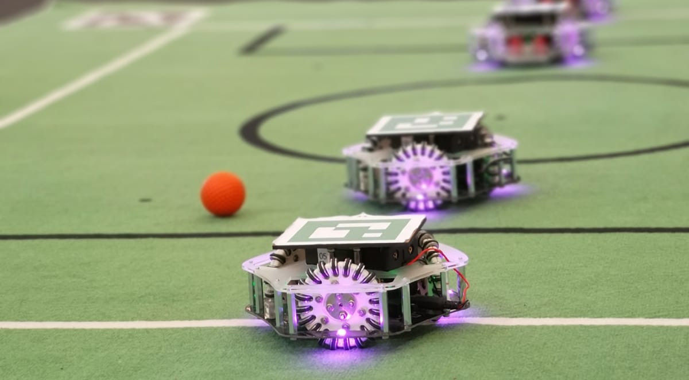

# Robot Soccer Kit



## Presentation

* [YouTube demonstration video](https://www.youtube.com/watch?v=4NFXbaom7YQ)
* [Documentation](https://robot-soccer-kit.github.io)

The changes of each version are listed in [CHANGELOG.md](CHANGELOG.md).

## Installation

Python 3.9 or newer is required. The Game Controller (interface, vision, referee) needs the `gc`
extra:

```
pip install -U "robot-soccer-kit[gc]"
```

Only the client (to program the robots from Python) is installed without the extra:
`pip install -U robot-soccer-kit`.

**Windows**: double-click `game-controller.bat`. It installs (or updates) the package and starts
the Game Controller. It uses the `py` launcher, installed with Python from
[python.org](https://www.python.org/downloads/) (the Python of the Microsoft Store doesn't have
it).

## Game Controller

```
python -m rsk.game_controller
```

The interface opens in the browser at http://127.0.0.1:7070. Options:

| Option | Effect |
|---|---|
| `-s`, `--simulated` | Simulated robots and ball, no camera needed |
| `-c`, `--competition` | Competition mode |
| `-S URL`, `--scheduler URL` | Games of a scheduler |
| `-R FILE`, `--replay FILE` | Replay a recorded game |
| `--ip IP`, `-p PORT` | Address and port of the interface |
| `-r`, `--reset` | Reset the configuration file |
| `-d`, `--dry` | Start and stop without serving the interface (installation check) |

The configuration (robots, cameras, settings) is saved in `config.json`. Robots are not saved in
simulation and replay modes, so a simulated run doesn't replace the real robots. Recorded games
are written in `rsk_recorder/`, in the directory where the Game Controller is started.

### Vision

In the **Vision** tab:

* **Camera and resolution**: a preview of the chosen camera is shown before the vision starts.
  On Linux, the cameras are listed with their names, and only the resolutions they can give
  are proposed (with their frame rate).
* **Settings per camera**: the camera settings and the lens calibration are saved for each
  camera; changing the camera brings back its settings. A camera used for the first time gets
  its own default image settings (when known, Linux).
* **Auto**: sets the image settings to the defaults of the camera, then searches the exposure
  (brightest parts of the field bright but not saturated, or a medium brightness when the
  field is not calibrated yet: run it again once the four field markers are visible).
* **Auto crop**: crops the image to the field and the border around it.
* **Lights**: 50 Hz, 60 Hz or none. With 50 or 60 Hz, the exposure is a multiple of the
  flickering period of the lights, to avoid bands on the image.
* **Lens calibration** (Camera tab): see below.

The default focal (935) is the one of the recommended camera. A configuration that still has the
previous default (885) is updated, a custom focal is kept.

### Lens calibration

Wide angle lenses distort the image: without calibration, positions near the field borders can
be wrong by 1 to 2.5 cm (a few millimeters with it). The calibration measures the focal, the optical center and the
distortion with a ChArUco board (a chessboard with ArUco markers, the size doesn't matter):

1. Download the board from the *Lens calibration* card (Vision tab), print it, glue it on a
   flat rigid support.
2. Start the calibration and move the board in front of the camera: a view is captured each
   time the board is still in a new position (a green frame is shown). At least 30 views are
   needed, and all the zones of the coverage grid must be green (bring the board in the
   corners).
3. Compute, check the result (reprojection error, focal, field of view), then apply. The focal
   setting is also set to the measured focal.

The calibration is used only at the resolution it was made with. The same calibration can be
done with a command line tool:

```
python -m rsk.calibrate_camera --generate            # writes calibration_board.png
python -m rsk.calibrate_camera --camera 0            # live calibration ('q' cancels)
python -m rsk.calibrate_camera --images "views/*.png"
```

### Windows specifics

On Windows, OpenCV doesn't give the names, the resolutions nor the ranges of the settings of the
cameras:

* the cameras are listed by index, all the resolutions are proposed;
* the exposure is the log2 of the exposure time in seconds (e.g. `-7` for 1/128 s), so it can't
  follow the flickering of the lights, and the anti-flicker of the camera is not set;
* the automatic settings only search the exposure (the defaults of the camera are unknown).

## Development

The project is managed with [uv](https://docs.astral.sh/uv/):

```
uv sync --extra gc
uv run -m rsk.game_controller -s
```

### Tests

```
uv run --extra gc --group dev pytest tests
```

The test dependencies (pytest, hypothesis, playwright) are only installed with `--group dev`.
No Game Controller should be running (the tests use the ports 7557 and 7558).

* **Interface tests** (`tests/test_ui.py`) run in a headless Chrome, or Chromium installed with
  `uv run --group dev playwright install chromium`. They are skipped without a browser.
* **Tests with real cameras** (`tests/test_cameras_hardware.py`) are skipped unless
  `RSK_TEST_CAMERAS=1`. They check the listing, resolutions, preview rate, automatic settings
  and vision with the cameras plugged in (no other program should use them). They change the
  settings of the cameras (until unplugged), not the configuration file:

  ```
  # Linux / macOS
  RSK_TEST_CAMERAS=1 uv run --extra gc --group dev pytest tests/test_cameras_hardware.py -v -s
  # Windows (PowerShell)
  $env:RSK_TEST_CAMERAS=1; uv run --extra gc --group dev pytest tests/test_cameras_hardware.py -v -s
  ```

The CI runs the tests on Linux, macOS and Windows, with Python 3.9 to 3.14.

### Other commands

```
make format   # ruff format rsk/ tests/
make test     # tests
make          # build the package (python -m build)
```

## License

<a rel="license" href="http://creativecommons.org/licenses/by-nc/2.0/"></a><br />This work is licensed under a <a rel="license" href="http://creativecommons.org/licenses/by-nc/2.0/">Creative Commons Attribution-NonCommercial 2.0 Generic License</a>.
